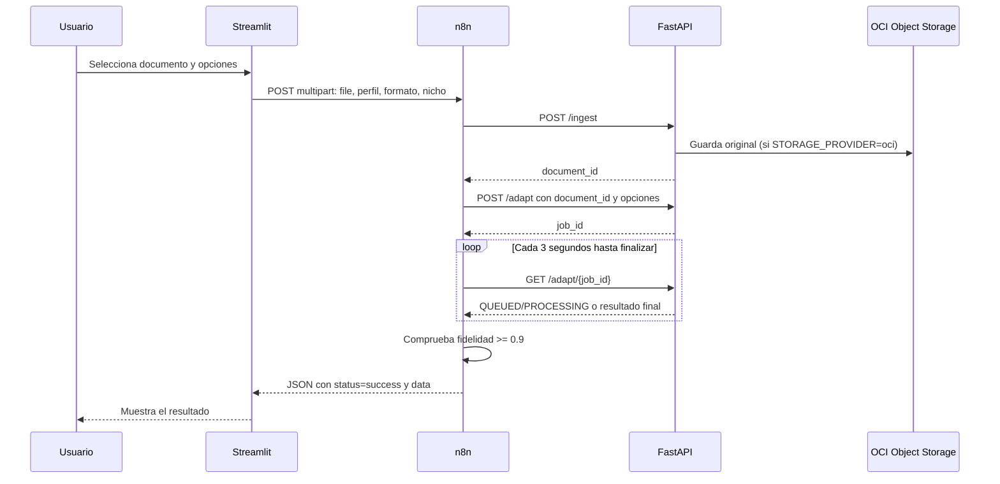
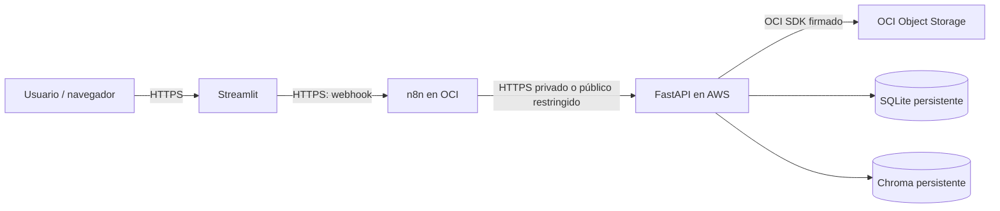

# Integración NuevaMente: Streamlit, n8n, FastAPI y despliegue AWS + OCI

- **Fecha:** 22 de octubre de 2026
- **Commit de la integración:** `38d562d` (`feat: conectar Streamlit con workflow n8n`)
- **Estado:** flujo local probado de extremo a extremo. La ejecución observada en n8n terminó en `Succeeded`; Streamlit mostró fidelidad de 100%.

## Resumen ejecutivo

Streamlit envía a n8n un formulario multipart con el documento y las opciones pedagógicas. n8n llama a la API FastAPI para ingerir el documento, solicitar la adaptación y consultar el job hasta que termina. Luego evalúa la fidelidad y devuelve el resultado a Streamlit únicamente cuando el puntaje es igual o superior a `0.9`.

El commit `38d562d` modificó la interfaz, el workflow exportado y su documentación. **No modificó el código del backend FastAPI**: n8n reutiliza los endpoints que ya existían.

La ejecución local observada el 22 de octubre terminó correctamente en aproximadamente 1 min 52 s; el workflow completó el bucle de consulta y llegó a `Respond Success`. El puntaje es el resultado del validador configurado, no una garantía matemática de ausencia de alucinaciones.

## Recorrido de una solicitud



En producción, las flechas entre servicios deben usar direcciones privadas o nombres DNS con HTTPS; `localhost` solo sirve cuando los procesos comparten la misma máquina o namespace de red.

## Cambios realizados

### Interfaz Streamlit

- `ui/api_client.py`: se agregó `N8N_WEBHOOK_URL`, cuyo valor local predeterminado es `http://localhost:5678/webhook/webhook-nuevamente-v2`.
- Se agregó `submit_to_workflow(...)`: envía `file` como multipart y los campos `perfil`, `formato` y `nicho`; usa timeout de 300 segundos, traduce errores de conexión/timeout y verifica que n8n devuelva `status=success` y un objeto `data`.
- `ui/components/upload_view.py`: conserva temporalmente los bytes y el nombre del archivo para enviarlos junto con las opciones en el paso siguiente. El selector se limitó a PDF, Markdown y TXT, que son los formatos admitidos por el backend.
- `ui/components/selection_view.py`: el botón final envía el documento y las tres opciones al webhook. Al recibir `data`, pasa directamente a Resultados; ya no crea el job llamando a FastAPI desde esta pantalla.
- `ui/components/result_view.py`: al iniciar un documento nuevo, también limpia el archivo guardado en la sesión.
- `ui/components/error_view.py`: se agregaron mensajes para errores del webhook, timeout, respuesta inválida y rechazo por fidelidad.

El valor predeterminado `API_URL=http://localhost:8000` ya estaba como cambio local en `ui/api_client.py` antes de esta tarea y quedó incluido al stagear ese archivo para el commit. La ruta nueva de envío Streamlit → n8n usa `N8N_WEBHOOK_URL`.

### Workflow n8n

El export versionado está en [`n8n-workflows/webhook-nuevamente-v2 (2).json`](../n8n-workflows/webhook-nuevamente-v2%20%282%29.json).

- Webhook `POST /webhook-nuevamente-v2`, que recibe el archivo binario `file` y los campos del formulario.
- `Ingest Document`: envía el archivo a `POST /ingest`.
- `Request Adaptation`: usa el `document_id` de la ingesta y ahora lee `perfil`, `formato` y `nicho` del cuerpo del webhook, en lugar de valores fijos.
- `Wait 3 seconds` y `Check Job Status`: consultan `GET /adapt/{job_id}` hasta que el estado ya no sea `QUEUED` ni `PROCESSING`.
- `Check Fidelity Score`: usa una comparación numérica y trata `null` como cero. Solo deja pasar resultados con puntaje `>= 0.9`.
- `Respond Success`: devuelve JSON con `status: success`, `data` y metadatos.
- `Respond Fidelity Error`: devuelve `FIDELIDAD_BAJA` con HTTP 400 cuando el puntaje no alcanza el umbral.

El workflow utiliza `localhost:8000` en sus tres nodos HTTP. Esa dirección debe cambiarse al endpoint alcanzable de AWS al migrar.

### Backend FastAPI

**No hubo cambios de backend en el commit `38d562d`.** La integración utiliza este contrato existente:

| Endpoint | Uso por n8n | Contrato relevante |
|---|---|---|
| `GET /health` | Verificación básica | `200 {"status":"ok"}` |
| `POST /ingest` | Sube el formulario multipart `file` | `201` con `document_id`; acepta PDF, Markdown y TXT, límite predeterminado de 10 MB |
| `POST /adapt` | Solicita adaptación en segundo plano | `202` con `job_id` y estado |
| `GET /adapt/{job_id}` | Consulta el job | `202` con `QUEUED`/`PROCESSING`, o `200` con el resultado final |

El backend tiene `FIDELITY_THRESHOLD=0.90` como configuración predeterminada; el workflow también contiene `0.9`. Mantener ambos valores alineados evita que API y orquestación apliquen criterios diferentes.

## Configuración local actual

| Componente | Dirección o valor local |
|---|---|
| Streamlit | `http://localhost:8501` |
| FastAPI | `http://127.0.0.1:8000` |
| Webhook activo n8n | `http://localhost:5678/webhook/webhook-nuevamente-v2` |
| Webhook de prueba n8n | `http://localhost:5678/webhook-test/webhook-nuevamente-v2` |

La UI lee `N8N_WEBHOOK_URL` del entorno del proceso Streamlit. Para usar el webhook de prueba, esa variable se debe exportar **antes** de iniciar Streamlit. En producción, se recomienda inyectar las variables con el gestor de servicios o de secretos, no depender de una terminal interactiva.

## Despliegue objetivo: backend en AWS; n8n y Object Storage en OCI

### Topología propuesta



La llamada al webhook sale del proceso servidor Streamlit, no del navegador. Si Streamlit se ejecuta en AWS, su `N8N_WEBHOOK_URL` debe ser una dirección de n8n que la VM de AWS pueda resolver y alcanzar.

### 1. Elegir conectividad entre nubes

**Preferida para producción:** VPN sitio a sitio entre AWS y OCI, o conectividad privada equivalente. Usar CIDR que no se solapen, rutas explícitas, DNS privado y reglas de firewall limitadas a los puertos necesarios.

**Alternativa inicial:** endpoints públicos con HTTPS y certificados válidos. En AWS, publicar FastAPI detrás de un Application Load Balancer o proxy TLS y restringir el Security Group a los orígenes autorizados. En OCI, limitar el ingreso a n8n y el egreso del backend a lo requerido. Si n8n necesita una IP de egreso estable para una allowlist, diseñarla con NAT y comprobar la dirección observada desde OCI.

No usar estas direcciones entre máquinas diferentes:

- `http://localhost:8000` en n8n apunta al host/contenedor de n8n, no a AWS.
- `http://localhost:5678` en Streamlit apunta al host de Streamlit, no a OCI.

### 2. Preparar la VM de AWS para FastAPI

1. Crear una VM con una versión de Python compatible (3.11 o superior), disco persistente y acceso administrativo limitado.
2. Clonar el repositorio en una ruta de servicio y crear el entorno virtual.
3. Instalar las dependencias normales y las de OCI:

   ```bash
   cd nuevamente
   python3.11 -m venv .venv
   source .venv/bin/activate
   pip install -r backend/requirements-oci.txt
   ```

4. El script local `run_api.sh` no especifica `--host`; Uvicorn por defecto escucha en loopback. Para aceptar conexiones desde la red privada/proxy, el comando de servicio debe enlazar la interfaz necesaria, por ejemplo:

   ```bash
   cd /opt/nuevamente/backend
   /opt/nuevamente/.venv/bin/python -m uvicorn src.api.main:app --host 0.0.0.0 --port 8000
   ```

   `0.0.0.0` no significa que el puerto deba quedar abierto a Internet. Mantener el puerto 8000 en la red privada o aceptar conexiones solo desde el proxy/ALB y orígenes aprobados. Terminar TLS en el ALB o proxy.

5. Ejecutar API y Streamlit como servicios supervisados (por ejemplo, `systemd`), con usuario sin privilegios, reinicio controlado, logs centralizados y variables de entorno cargadas desde un archivo protegido o Secrets Manager/Parameter Store. No usar una terminal SSH como supervisor de producción.

### 3. Cambiar el workflow para llegar desde OCI a AWS

En los nodos `Ingest Document`, `Request Adaptation` y `Check Job Status`, reemplazar `http://localhost:8000` por la URL real de AWS. Ejemplo ilustrativo:

```text
https://api.ejemplo.edu
```

Las rutas quedarían:

```text
POST https://api.ejemplo.edu/ingest
POST https://api.ejemplo.edu/adapt
GET  https://api.ejemplo.edu/adapt/{job_id}
```

Mejor que repetir el host en tres nodos es configurar una variable/credencial de entorno en n8n y construir las URLs desde ella, si la versión instalada lo permite. Importar el JSON en n8n no cambia automáticamente el workflow ya guardado; después de editar, guardar, activar la versión correcta y desactivar la anterior que use el mismo path.

El workflow actual no configura autenticación en el Webhook ni agrega credenciales a las solicitudes hacia FastAPI. **No publicar ambos endpoints sin protección.** Antes de producción, usar conectividad privada y controles de red, y agregar autenticación de servicio: credencial Header Auth en el webhook y validación de credencial/API key en FastAPI, con el cliente Streamlit enviando el secreto y n8n enviándolo a la API. Guardar secretos en gestores de secretos, no en el JSON exportado, Git, capturas ni variables visibles en el editor.

### 4. Configurar el webhook de producción para Streamlit

La URL activa local usa `/webhook/`; en una VM se debe usar el DNS HTTPS alcanzable desde la VM de Streamlit:

```text
N8N_WEBHOOK_URL=https://n8n.ejemplo.edu/webhook/webhook-nuevamente-v2
```

`/webhook-test/` es solo para pruebas manuales con el botón de ejecución/escucha de n8n. No configurar esa ruta en el servicio estable.

El cliente espera hasta 300 segundos. Configurar ALB, proxy inverso y límites de tiempo del servicio para que no corten antes de que n8n responda. El ciclo actual de polling espera 3 segundos entre consultas; la ejecución observada tardó cerca de 1 min 52 s.

### 5. Configurar OCI Object Storage desde AWS

El backend ya tiene cliente OCI, seleccionado mediante configuración:

```text
STORAGE_PROVIDER=oci
OCI_CONFIG_FILE=/opt/nuevamente/secrets/oci-config
OCI_PROFILE=DEFAULT
OCI_BUCKET_NAME=<bucket-privado>
OCI_NAMESPACE=<namespace-de-la-tenancy>
```

- Instalar `backend/requirements-oci.txt`; incluye el SDK `oci`.
- Crear un usuario técnico/credencial API en OCI con permisos mínimos para los objetos y el bucket que necesita NuevaMente. No usar una cuenta personal ni privilegios de administrador.
- Como el backend corre en AWS, no puede usar la identidad dinámica de una instancia OCI; el cliente actual espera un perfil de OCI config y una llave API. Entregar esos archivos mediante un gestor de secretos, limitar permisos de lectura al usuario del servicio y rotar la llave.
- Mantener el bucket privado, habilitar cifrado y definir retención/versionado según la política del equipo. Probar `put`, `head` y `list` desde la VM antes de activar tráfico real.
- La conectividad de AWS hacia el endpoint Object Storage de OCI requiere salida HTTPS. No guardar la llave privada en el repositorio ni dentro del bucket accesible públicamente.

### 6. Persistencia, IA y configuración no mock

Los valores por defecto son de desarrollo y no se deben llevar sin revisar a producción:

| Variable | Predeterminado actual | Recomendación antes de producción |
|---|---|---|
| `STORAGE_PROVIDER` | `mock` | `oci` y validar credenciales/bucket |
| `VECTORSTORE_PROVIDER` | `memory` | `chroma` en volumen persistente o diseñar un vector store administrado |
| `LLM_PROVIDER` | `mock` | Seleccionar proveedor real aprobado y guardar su API key en un gestor de secretos |
| `EMBEDDING_PROVIDER` | `mock` | Seleccionar proveedor real y conservar la misma configuración/dimensiones para indexar y consultar |
| `DATABASE_URL` | SQLite local | Conservar SQLite solo para una instancia con disco persistente; alta disponibilidad requiere migrar el código a una base administrada, porque actualmente la configuración valida únicamente `sqlite:///` |
| `FIDELITY_THRESHOLD` | `0.90` | Acordar el umbral con el equipo y mantenerlo igual en backend y nodo IF de n8n |

SQLite guarda documentos, chunks y jobs. Chroma embebido usa disco local cuando se selecciona. En AWS, ubicar ambos directorios en almacenamiento persistente con backups y permisos adecuados; una instancia efímera o escalar varias réplicas sin cambiar persistencia puede perder estado o causar resultados inconsistentes.

El backend puede recurrir a una generación mock si falla el LLM; el estado y las observaciones del resultado deben revisarse y no confundirse con una respuesta generada por el proveedor real. Validar el comportamiento de fidelidad con casos controlados antes de aceptar tráfico productivo.

### 7. Variables mínimas por servicio

Ejemplo orientativo; los dominios, nombres y secretos son placeholders:

**API en AWS** (variables leídas por `backend/src/core/config.py`):

```dotenv
ENVIRONMENT=production
LOG_LEVEL=INFO
CORS_ORIGINS=["https://app.ejemplo.edu"]
MAX_FILE_SIZE_MB=10
STORAGE_PROVIDER=oci
OCI_CONFIG_FILE=/opt/nuevamente/secrets/oci-config
OCI_PROFILE=DEFAULT
OCI_BUCKET_NAME=<bucket-privado>
OCI_NAMESPACE=<namespace>
VECTORSTORE_PROVIDER=chroma
CHROMA_PERSIST_DIR=/data/nuevamente/chroma
DATABASE_URL=sqlite:////data/nuevamente/sqlite/nuevamente.db
LLM_PROVIDER=<proveedor-aprobado>
EMBEDDING_PROVIDER=<proveedor-aprobado>
FIDELITY_THRESHOLD=0.90
```

`CORS_ORIGINS` solo aplica a llamadas desde navegadores; las llamadas de Streamlit y n8n son servidor a servidor y no dependen de CORS. No usar `[*]` como solución de conectividad.

**Streamlit** (variables del proceso/servicio UI):

```dotenv
N8N_WEBHOOK_URL=https://n8n.ejemplo.edu/webhook/webhook-nuevamente-v2
API_URL=https://api.ejemplo.edu
```

`API_URL` se conserva para funciones directas del cliente que puedan seguir usándose; el envío del flujo integrado usa `N8N_WEBHOOK_URL`.

### 8. Seguridad y operación

- FastAPI no implementa autenticación en el código actual; CORS no es autenticación. No exponer `/ingest` y `/adapt` anónimamente a Internet.
- Proteger el webhook de n8n con credencial y limitar quién puede invocarlo. Evitar que una URL pública permita consumir recursos o subir documentos sin autorización.
- Usar TLS en ambos saltos, restringir Security Groups/NSG y evitar puertos de administración abiertos a todo Internet.
- Mantener PDF/documentos y resultados privados; definir retención/borrado, cifrado y acceso auditable. El contenido puede incluir datos personales o sensibles.
- Proteger SQLite, Chroma, config OCI, llaves de proveedores y logs. No registrar cuerpos completos de documentos ni secretos.
- Configurar backups y probar restauración de SQLite/Chroma; Object Storage no sustituye los respaldos del estado local del backend.
- La API tiene `GET /health`, pero es una prueba básica de vida; no verifica por sí sola OCI, SQLite, Chroma ni el proveedor de IA.
- Habilitar retención de ejecuciones exitosas en n8n durante las pruebas; en producción fijar una política de retención que no acumule documentos o datos sensibles innecesariamente.

## Lista de verificación para migración

- [ ] Definir DNS, TLS y conectividad AWS ↔ OCI; probar DNS, rutas y HTTPS desde las VMs.
- [ ] Desplegar FastAPI detrás de TLS; comprobar que el puerto de aplicación no sea público.
- [ ] Desplegar Streamlit y configurar `N8N_WEBHOOK_URL` con el webhook activo de OCI.
- [ ] Cambiar los tres nodos HTTP de n8n a la URL HTTPS de FastAPI en AWS.
- [ ] Configurar autenticación entre Streamlit → n8n y n8n → FastAPI antes de exponerlos.
- [ ] Configurar OCI Object Storage privado, credencial técnica de mínimo privilegio y `STORAGE_PROVIDER=oci`.
- [ ] Cambiar `memory` a almacenamiento persistente y definir respaldo de SQLite y Chroma.
- [ ] Elegir proveedores reales para LLM/embeddings, guardar secretos fuera de Git y probar respuestas de fallback.
- [ ] Alinear el umbral `0.90` entre backend y workflow.
- [ ] Confirmar límite de carga de 10 MB en Streamlit, n8n, proxy y API; ajustar solo con memoria/capacidad suficiente.
- [ ] Configurar timeout de extremo a extremo superior a 300 segundos o rediseñar el webhook para respuesta asíncrona.
- [ ] Ejecutar casos de éxito, fidelidad menor a umbral, archivo inválido, timeout y pérdida de conectividad; revisar logs y ejecuciones n8n.
- [ ] Probar backup y restauración antes de declarar el entorno productivo.

## Referencias del repositorio

- Workflow versionado: [`n8n-workflows/webhook-nuevamente-v2 (2).json`](../n8n-workflows/webhook-nuevamente-v2%20%282%29.json)
- Configuración backend: [`backend/src/core/config.py`](../backend/src/core/config.py)
- Endpoints FastAPI: [`backend/src/api/main.py`](../backend/src/api/main.py)
- Cliente OCI Object Storage: [`backend/src/storage/oci_client.py`](../backend/src/storage/oci_client.py)
- Cliente HTTP de Streamlit: [`ui/api_client.py`](../ui/api_client.py)
- Commit de integración: `38d562d`